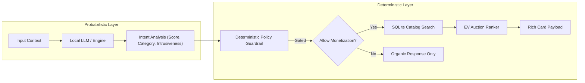

# System Architecture Document: AdVantage-Edge

## 1. Architectural Philosophy: Decoupled Safety & Determinism

A core design principle of AdVantage-Edge is the explicit **decoupling of probabilistic LLM inference from deterministic safety gating and auction ranking**.

### Why Decouple LLMs from Safety & Auctions?
1. **Zero Hallucination Tolerance**: LLMs are probabilistic models subject to output variance, hallucination, and prompt injection. Relying solely on an LLM to decide whether an ad is brand-safe introduces unacceptable compliance risk for Google Ads policies.
2. **Determinism in Safety Enforcement**: Hard policy guardrails (e.g. suppressing ads during medical emergencies or grief) must execute with mathematical certainty ($100.0\%$ suppression rate).
3. **Execution Latency Efficiency**: Performing semantic ranking in SQLite using vectorized EV math takes $<10\text{ms}$, whereas forcing an LLM to generate complex SQL or search catalog DBs directly causes prohibitive latency ($>2000\text{ms}$) and high compute costs.

---

## 2. Component Subsystems

### 2.1 Dual-Head Intent & Intrusiveness Engine (`src/engine.py`)
- Communicates with local LLM runtimes (e.g., Ollama running `gemma2:2b`, `qwen2.5:3b`, or `mistral:7b`) via an OpenAI-compatible JSON endpoint.
- Features a deterministic, rule-based local mock engine fallback ensuring 100% offline functionality without requiring an active daemon process.
- Outputs continuous metrics:
  - $\text{Commercial Intent Score} \in [0.0, 1.0]$
  - $\text{Intrusiveness Risk Score} \in [0.0, 1.0]$
  - $\text{Category Classification}$

### 2.2 Deterministic Safety Guardrail (`src/guardrails.py`)
- Evaluates policy compliance using hard thresholds and keyword safety nets:
  - **Zero-Tolerance Prohibited Categories**: `medical_emergency`, `mental_health_crisis`, `political_debate`, `tragedy_violence`, `legal_distress`, `self_harm`, `elections`.
  - **Narrative Intrusiveness Gate**: $\text{Intrusiveness Score} > 0.65 \implies \text{SUPPRESS}$.
  - **Commercial Intent Gate**: $\text{Commercial Intent Score} < 0.70 \implies \text{SUPPRESS}$.

### 2.3 Catalog Retrieval & Expected Value Auction Ranker (`src/auction.py`)
- Connects to SQLite database (`data/catalog.db`) indexing commercial inventory across 6 verticals (electronics, home improvement, fashion, sports, wellness, automotive).
- Calculates Expected Value (EV) score for candidate ranking:
  $$\text{Score} = (\text{Bid}_{\text{eCPM}} \times 0.4) + (\text{Relevance}_{\text{Score}} \times 0.4) + (\text{Historical}_{\text{CTR}} \times 0.2)$$
- Returns top-1 candidate to synthesize YouTube Shoppable Card / RCS Business Messaging JSON payload.

### 2.4 End-to-End Pipeline Orchestration (`src/pipeline.py`)
- Combines ingestion, evaluation, guardrails, auction, and payload synthesis while recording microsecond execution latencies.
